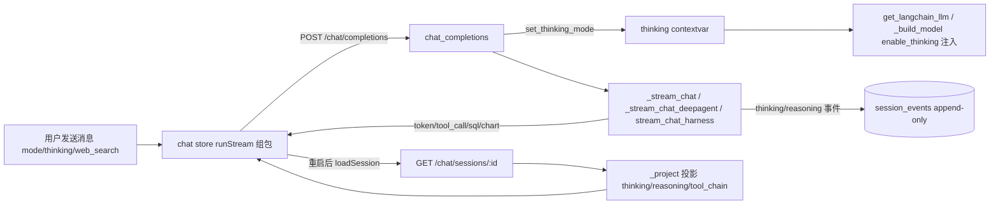

## User Requirements

用户提出 5 项前端优化（已确认允许前后端一起改）：

1. **登录页**：体现项目简介和 LOGO，参考根目录 README（项目定位：面向业务人员的多智能体数据分析平台；已有 `assets/logo.png`）。
2. **会话侧栏**：补齐分组、折叠、滚动加载、批量操作管理（当前仅 antdx Conversations + 今天/昨天/更早分组 + 单项菜单）。
3. **聊天输入区**：多模式切换（数据分析/研究报告/文档智读/通用任务）重做为 Sender.Header 下拉切换面板（图标+名称+一句话说明，替代 Segmented）；联网搜索与思考模式参考 Sender 组件重设计，思考模式设计为开关且默认关闭，语义为「显隐 + 传参后端」（需后端新增 thinking 参数）。
4. **历史会话恢复**：修复重启前端后切换旧对话时思考内容和工具调用步骤丢失的问题。根因：后端 event_sourcing 从不持久化 thinking/reasoning 事件；前端 loadSession 未映射 tool_chain 投影类型（落成空文本气泡）。
5. **Markdown 渲染**：统一优化（代码块高亮+复制、表格横向滚动、链接新窗口、XSS 防护、流式渲染稳定性），并覆盖思考卡/工具卡等纯文本区域。

## Product Overview

DataAgent Pro 对话工作台的前端交互与渲染层升级：登录页建立品牌第一印象；会话侧栏支持大数据量下的分组折叠、滚动加载与批量管理；输入区以模式切换面板 + 双开关（联网搜索/思考模式）提供清晰的能力控制；历史会话完整恢复思考过程与工具步骤；全站 Markdown 渲染达到生产级阅读体验。

## Core Features

- 登录页：真实 LOGO + 项目简介 + 特性标签 + 登录表单（暗色驾驶舱风格延续）
- 会话侧栏：分组计数与折叠、滚动分页加载、批量管理模式（全选/批量删除/确认弹窗）
- 输入区：模式切换下拉面板（含路由说明）、联网搜索开关、思考模式开关（默认关、localStorage 持久化、模型不支持时禁用）
- 历史恢复：thinking/reasoning/tool_chain 事件持久化 + 投影 + 前端映射，重启后思考卡与工具卡完整可见
- Markdown：代码块语法高亮与一键复制、表格横向滚动、外链新窗口、原始 HTML 转义防 XSS

## Tech Stack Selection

- 前端（现有栈，不引入新框架）：React 18.3 + TypeScript + Vite 5 + antd 6 + @ant-design/x 2.9（Sender/Conversations/XMarkdown）+ zustand + Tailwind CSS；新增 highlight.js（已在 node_modules，需确认并固化为直接依赖）做代码高亮
- 后端（现有栈）：FastAPI + Pydantic + SQLAlchemy；事件溯源（session_events append-only + surface 投影）作为历史恢复的唯一事实来源
- 测试/验证：前端 vitest（vitest.config.ts 已配置 src/**/*.test.ts(x)）+ npm run build（tsc -b + vite build）；后端 pytest（pyproject dev 依赖已含）；Chrome DevTools MCP 端到端实测（用户协作约定）

## Implementation Approach

总体策略：先后端契约、再前端 store、后 UI 组件、最后 E2E 实测。后端先落地「thinking 请求参数 → contextvar → 模型注入」与「thinking/reasoning 事件持久化 + 投影 + 会话分页」三件契约；前端 store 层消费契约（loadSession 映射、thinking 状态、分页状态、批量动作）；UI 层（登录页/侧栏/输入区/Markdown）基于 store 能力重做。

关键决策与理由：

1. thinking 传参走 contextvar（与现有 set_provider 完全同款）：请求入口设置、LLM 构建处读取，避免改动三条流式生成器的函数签名，blast radius 最小；默认值 True 保持既有行为（只增不改）。
2. 模型注入按能力门控：仅当 provider 配置表明支持思考（thinking_mode/capabilities.thinking，复用现有配置字段）且开关关闭时，才传 model_kwargs={"enable_thinking": False}，避免不支持的网关 400；_langchain_models 缓存 key 追加 thinking 标志防串用。
3. 事件溯源持久化 thinking/reasoning：新增 EventType.THINKING/REASONING，三条流式路径（legacy/deepagent/harness）在 yield 处同步 _track；_project() 投影为 type:"thinking"/"reasoning"（带 agent/phase/step_id），前端 loadSession 显式映射（tool_chain→kind 'tool'、thinking→'thinking'、reasoning→'reasoning'），历史工具卡经 buildBlocks 既有 synthStepsFromTools 自动归组，零额外步骤重建逻辑。
4. 会话分页保持向后兼容：limit/offset 查询参数，默认 None=全量（旧调用方无感）；前端每页 30 条，滚动触底加载，hasMore/loading 守卫防重入。
5. 模式切换用下拉面板而非 Segmented/词槽：后端 mode 是请求级参数（SOP + Profile 路由：task→DeepAgent，其余→LangGraph），并非真实多智能体；下拉面板可承载「图标+名称+说明+路由提示」，信息量与扩展性优于分段器，且不误导为多 Agent 选择。
6. Markdown 封装为独立组件（components/bits/Markdown.tsx）：module 级稳定 components 映射对象（遵循 x-markdown 开发规则，避免内联对象导致重渲染与打字动画重置）；escapeRawHtml + 内置 DOMPurify 双保险；流式配置透传。

性能考量：

- highlight.js 按需 registerLanguage（core + 常用语言），避免整包打入 bundle；流式中（streamStatus≠done）跳过高亮、仅纯文本，完成后高亮（遵循 x-markdown 规则）。
- 侧栏分页请求带 AbortController，切页/卸载中止 stale 请求；已知瞬态（loadSessions abort 后空列表）加一次自动重试。
- 批量删除走现有 DELETE 端点并行调用（典型会话量级小于 100），不新增后端端点；部分失败收集汇报，不静默。
- 历史映射 O(n) 单遍；buildBlocks 复用现有序聚合，无额外遍历。

避免技术债：全部改动沿袭现有模式（contextvar provider 路由、事件只增不改、zustand store 编排与 reducer 纯函数分离、antdx 官方槽位），不引入新架构；harness/stream_harness.py:196 未定义的 _es_fired/_es_track（HARNESS_MODE=on 时 NameError）顺手修复。

## Implementation Notes

- SSE 协议只增不改：事件名 thinking/reasoning/tool_call/tool_result 不变；历史投影新增 type: thinking/reasoning/tool_chain 由前端映射。
- 前端 thinking 状态与 store 现有 thinkingModeEnabled（模型能力派生）解耦：用户偏好 thinking（localStorage，默认 false）+ 模型能力 thinkingCapable（config store 派生，不支持时开关禁用并 Tooltip 说明）。
- 发送请求体新增 thinking 字段（stores/chat.ts runStream 组包处）；DataAgentProvider.ts 无需改动（透传 body）。
- 登录页 LOGO：拷贝 assets/logo.png 到 frontend-react/public/logo.png，img 引用；favicon 可同步替换。
- 主题沿用 CSS 变量（--cockpit-800/900、--panel、--text-1/2/3、--border）与品牌紫 #7056F8；x-markdown 主题类名已由 main.tsx 按 html class 切换，勿引入包内 CSS。
- 后端改动后 DeepAgent 为全局单例，涉及 harness/tools 的改动需整进程重启（项目约定）；本次 LLM 注入改动影响 _build_model/get_langchain_llm 缓存，重启后生效。
- 端口约定：本机 8000 被占用，后端用 8001；vite dev 默认代理 BACKEND_PORT=8001。

## Architecture Design



- 契约层：ChatRequest.thinking + SSE 事件不变 + 投影类型只增；GET /chat/sessions 增 limit/offset（默认全量）。
- 领域层：前端 stores/chat.ts 编排（分页加载/批量/thinking 偏好），sdk/reducer.ts 保持纯函数；新增 sdk/history.ts 纯函数承载历史消息映射（可单测）。
- 展示层：Login / ChatSidebar / ModeSwitcher / SenderInput / Markdown 组件；antdx Conversations（groupable collapsible）、Sender.Header + Sender.Switch、XMarkdown components 映射。

## Directory Structure

```
DataAgent-Pro/
├── assets/logo.png                        # [沿用] 项目 LOGO 源文件
├── backend/app/
│   ├── api/v1/chat.py                     # [MODIFY] ChatRequest 增 thinking 字段；入口 set_thinking_mode；
│   │                                     #   list_sessions(:1795) 增 limit/offset（默认 None=全量）；
│   │                                     #   _stream_chat/_stream_chat_deepagent thinking 事件处补 _track(THINKING/REASONING)
│   ├── core/event_sourcing.py             # [MODIFY] EventType 增 THINKING/REASONING；_project() 增两类投影
│   │                                     #   （thinking→agent/phase/content、reasoning→content，payload 带 step_id 时输出 stepId）
│   ├── core/llm.py                        # [MODIFY] 新增 set_thinking_mode/get_thinking_mode contextvar（默认 True）；
│   │                                     #   get_langchain_llm 按能力注入 model_kwargs enable_thinking=False，缓存 key 含标志
│   ├── deepagent/harness.py               # [MODIFY] _build_model() 同样按能力注入 thinking 参数
│   └── harness/stream_harness.py          # [MODIFY] reasoning 事件落库 _track；修复 :196 未定义的 _es_fired/_es_track
├── frontend-react/
│   ├── public/logo.png                    # [NEW] 自 assets/logo.png 拷贝，登录页/侧栏/favicon 引用
│   ├── package.json                       # [MODIFY] highlight.js 固化为直接依赖（若当前为传递依赖）
│   └── src/
│       ├── pages/Login.tsx                # [MODIFY] LOGO+项目简介（README 定位语/特性标签）+登录表单+默认账号提示
│       ├── components/chat/ChatSidebar.tsx# [MODIFY] 分组计数标签、groupable collapsible（更早默认折叠）、
│       │                                 #   滚动触底分页加载、批量管理模式（勾选/全选/批量删除/确认弹窗）
│       ├── components/chat/ModeSwitcher.tsx# [NEW] 模式切换下拉面板：4 模式卡片（图标+名称+说明+路由提示），
│       │                                 #   当前项品牌色高亮+勾选，点击外部/Esc 关闭（沿用 e2e 已修交互约定）
│       ├── components/chat/SenderInput.tsx# [MODIFY] Header 装配 ModeSwitcher + Sender.Switch 联网/思考开关
│       │                                 #   （思考默认关、localStorage 持久化、模型不支持时禁用）；移除只读 THINKING 徽标
│       ├── components/bits/Markdown.tsx   # [NEW] XMarkdown 封装：code/pre 高亮+复制头、table 横向滚动包裹、
│       │                                 #   a 新窗口、escapeRawHtml；module 级稳定 components 映射；streaming 透传
│       ├── components/chat/MessageItem.tsx# [MODIFY] 文本气泡与 ThinkingBlock 改用具名 Markdown 组件
│       ├── components/chat/ReasoningCard.tsx# [MODIFY] 思考内容改 Markdown 渲染（替代 pre-wrap 纯文本）
│       ├── components/chat/ToolCard.tsx   # [MODIFY] 字符串类工具结果改 Markdown 渲染
│       ├── stores/chat.ts                 # [MODIFY] loadSession 显式映射 tool_chain/thinking/reasoning（经 sdk/history.ts）；
│       │                                 #   新增 thinking 偏好（默认 false、持久化）、分页状态（page/hasMore/loadingMore）与
│       │                                 #   loadMoreSessions/batchDeleteSessions/toggleSelect 等动作；sendMessage 请求带 thinking
│       ├── stores/config.ts               # [MODIFY] syncThinkingMode 拆分为能力派生 thinkingCapable（供开关禁用判断）
│       ├── sdk/history.ts                 # [NEW] 纯函数：后端投影消息转 Msg 领域类型映射（tool_chain/thinking/reasoning 等）
│       └── sdk/history.test.ts            # [NEW] vitest：覆盖各投影类型映射与未知类型兜底
└── backend/tests/test_event_projection.py # [NEW] pytest：_project 对 THINKING/REASONING/TOOL_CHAIN 的投影断言
```

## Key Code Structures

```python
# backend/app/api/v1/chat.py —— ChatRequest 增字段（只增不改，默认 True 保持既有行为）
class ChatRequest(BaseModel):
    ...
    thinking: bool = Field(
        default=True,
        description="是否开启模型思考：关闭时尽力禁用推理（enable_thinking=False）并隐藏思考展示",
    )
```

```python
# backend/app/core/llm.py —— 思考模式上下文（与 set_provider 同款 contextvar 模式）
def set_thinking_mode(enabled: bool) -> None: ...   # 请求入口调用（chat_completions）
def get_thinking_mode() -> bool: ...                # 模型构建处读取；默认 True
```

```python
# backend/app/core/event_sourcing.py —— 事件类型扩展（append-only，只增）
class EventType:
    ...
    THINKING = "thinking"      # 过程态：节点思考块（agent/phase/content）
    REASONING = "reasoning"    # 过程态：模型推理内容（content）
```

前端历史映射（sdk/history.ts）以纯函数实现：输入后端投影消息（role、type、content、sql、data、columns、chartConfig、toolName、toolMeta、agent、phase、stepId 等字段），输出 Msg 数组；tool_chain 映射为 kind='tool'、toolPhase='done'、collapsed=true；thinking 映射为 kind='thinking'；reasoning 映射为 kind='reasoning'、collapsed=true；未知类型保持既有 text 兜底，不抛错。

## 设计风格

整体延续「碳黑驾驶舱」暗色美学（Aurora 呼吸背景 + 毛玻璃卡片 + 品牌紫渐变），三块重做区域保持同一视觉语言：

**登录页**：全屏 Aurora 极光背景上居中 400px 玻璃卡片（rounded-2xl + backdrop-blur + shadow-2xl）。顶部品牌区：真实 LOGO（public/logo.png，36px 圆角）+「DataAgent Pro」semibold 标题 + 副标题「智能业务数据交互平台」；其下项目简介「面向业务人员的多智能体数据分析平台 · 用自然语言对话即可查询、分析与可视化企业数据」；一行特性标签 chips（Text-to-SQL / 多智能体协作 / 人工审批 / 流式响应，10px mono、紫色描边）；登录表单（大号输入框 + 品牌渐变主按钮 + 默认账号 admin/12345678 灰色小字提示）；底部保留 mono 追踪字距的「NATURAL LANGUAGE → DATA → INSIGHT」。入场 rise-in 动画。

**会话侧栏**：280px 面板，logo 区右侧新增「管理」按钮进入批量模式。会话列表按今天/昨天/更早分组，组标题带计数（如「今天 · 3」）与折叠箭头（更早默认折叠，折叠态 localStorage 记忆）；列表滚动触底自动加载下一页（底部 spinner 或「已加载全部会话」）；批量模式下条目左侧出现圆形勾选，顶部操作条显示「全选 / 取消 / 删除所选(N)」（danger 红），删除前 Modal.confirm。单条菜单保留重命名/长期目标/删除。

**输入区（Sender.Header）**：左侧模式切换触发器（模式图标 + 名称 + chevron），点击弹出 280px 下拉面板：4 张模式卡片（图标 + 名称 + 一句话说明 + 路由提示「LangGraph 工作流 / DeepAgent 调度」），当前项品牌紫描边并带勾选；面板外点击或 Esc 关闭。触发器右侧两个开关（Sender.Switch 样式）：联网搜索、思考模式（思考默认关闭，开关态 localStorage 持久化；当前模型不具备思考能力时禁用并 Tooltip 说明）。最右 ModelSelector 不变。空输入时上方仍占位建议 Prompts。

**Markdown 渲染**：正文/思考/工具结果统一走 Markdown 封装。代码块带头栏（语言标签 + 复制按钮，复制成功给出反馈）与 highlight.js 语法高亮（暗色配色贴合驾驶舱）；表格外层横向滚动防撑破气泡；外链新窗口打开；原始 HTML 转义防 XSS；流式期间光标 tail 与块级淡入，完成后 flush 终态。思考卡内容由纯文本升级为 Markdown（保留 Think 折叠交互）。

## Agent Extensions

### Skill

- x-components
- Purpose: 规范使用 @ant-design/x 的 Sender（Header/Switch 槽位）、Conversations（groupable collapsible、分组标签）等组件 API，避免猜测属性名
- Expected outcome: ModeSwitcher、侧栏分组折叠、输入区开关均按官方 API 落地，无属性误用
- x-markdown
- Purpose: 规范 Markdown.tsx 的 XMarkdown components 映射、streaming 配置、escapeRawHtml 与 dompurify 安全默认值、主题继承
- Expected outcome: 代码块高亮/复制、表格滚动、流式终态 flush 正确，无重复渲染与动画重置
- frontend-design
- Purpose: 登录页/侧栏/输入区的组件代码结构规范与生产级视觉质量
- Expected outcome: 重做 UI 代码结构清晰、视觉精良，避免通用 AI 审美
- ui-ux-pro-max
- Purpose: 应用现代 UI/UX 设计原则（配色、排版、微交互、响应式）
- Expected outcome: 三块区域视觉统一、交互反馈细腻

### MCP

- chrome-devtools
- Purpose: 按用户协作约定，改动完成后启动前后端做端到端浏览器实测（登录页、侧栏分组折叠/滚动/批量删除、模式面板、思考开关、历史会话恢复、Markdown 渲染）
- Expected outcome: 五项优化均经真实浏览器验证通过，输出实测结论