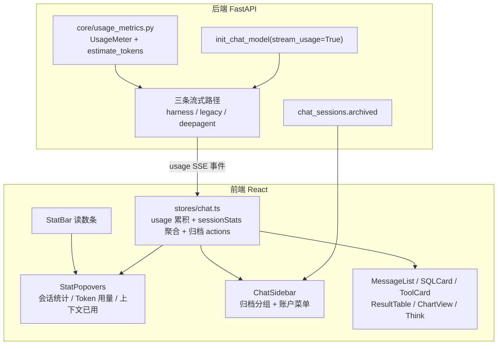

## User Requirements（本轮 7 项，用户已确认分两阶段）

**阶段 A：先修功能与可用性**

1. 登录页：去掉直接显示的默认账号密码（`admin / 12345678`）与底部标语「NATURAL LANGUAGE → DATA → INSIGHT」
2. 账号体系：补退出登录；去掉主界面冗余的账号显示（轨迹旁的用户名）；修复管理员配置界面无法进入
3. 上下文与统计：现有轨迹抽屉点击后空白且无法返回 → 取消它，改为 DeepSeek Harness 风格的三个可悬浮展开统计模块：**会话统计**（模型耗时 / 工具调用用时 / 首 token 平均 TTFT / 输出速度 TPS）、**Token 用量**（总量 / 缓存命中 / 未缓存输入 / 缓存读取 / 输出）、**上下文已用**（占比 + 进度条 + 系统提示词 / 工具定义 / 对话消息分解）
4. 会话管理：批量删除后刷新又回来（删除失败被吞）→ 修复真实删除；新增**归档**能力（归档 / 取消归档 / 归档列表 / 侧栏归档分组可恢复）
5. AI 消息渲染：SQL 输出改用 XMarkdown 代码高亮（去掉自绘纯文本与遗留渲染），工具输出卡片重做（当前不可用），修复结果表被挤成窄列、图表标题与类型徽标重叠
6. 思考过程：改用 @ant-design/x 组件（ThoughtChain / Think）统一呈现

**阶段 B：验收后做 React Bits 视觉重设计**（引入其源码组件 + motion 依赖，重做登录页/侧栏/消息区/输入区视觉）

## Product Overview

对话工作台从"能跑"补齐到"可信、可读、可管理"：账号进出与配置入口完整可用；会话可归档可恢复可真实删除；底部读数条升级为三项可展开的运行统计（性能 / Token / 上下文），数据来自真实用量而非估算；消息区达到生产级阅读体验（SQL 高亮、工具结果结构化、表格与图表布局正确）；思考过程以官方组件折叠呈现。

## Core Features

- 登录页：保留 LOGO / 项目简介 / 特性标签，仅移除默认账号提示与底部标语
- 账号：侧栏底部账户菜单承载「账户信息 / 配置中心（管理员） / 退出登录」，主界面不再重复显示账号
- 会话：归档分组 + 单条/批量归档与恢复；删除失败可见（不再吞错），删除后刷新不再复现
- 统计三弹窗：悬浮展开显示明细与占比，底部读数条形如「2 轮 29 步 · 35 tok/s」「1.9M tok · 缓存命中 13%」「49%」
- 渲染：SQL 走代码高亮块、工具卡结构化、表格列宽正确不折行、图表标题与徽标不重叠、块级卡片撑满消息宽度
- 思考过程：步骤链（ThoughtChain）+ 推理正文（Think）双层折叠，运行中展开、完成后自动折叠

## Tech Stack Selection

沿用现有栈，不引入新框架：

- 前端：React 18.3 + TypeScript + Vite 5 + antd 6 + @ant-design/x 2.9（Bubble / Conversations / Sender / Think / ThoughtChain / Popover）+ zustand + Tailwind + highlight.js（已固化直接依赖）
- 后端：FastAPI + Pydantic + SQLAlchemy（`chat_sessions` / `chat_nodes` / `session_events`）；SSE 协议只增不改
- 阶段 B 新增：`motion`（framer-motion）+ React Bits 源码组件（Context7 库 `/websites/reactbits_dev`，shadcn 式复制，非 npm 依赖）
- 验证：`tsc -b` + `vite build`（需 `TEMP/TMP` 指向 workspace 内目录，见 Additional Context）+ vitest + Chrome DevTools MCP 端到端

## Implementation Approach

**总体策略**：契约先行（后端 usage事件 + 归档字段）→ 前端数据层（protocol/store）→ UI 层（认证入口、统计弹窗、渲染与思考展示）→ E2E 验收 → 阶段 B 视觉。

### 决策 1：usage 采集走 `stream_usage=True` + 末块 `usage_metadata`（不新增 LLM 调用）

LangChain 的 `ChatOpenAI(stream_usage=True)` 会在每个 `AIMessageChunk` 上挂 `usage_metadata`（`input_tokens` / `output_tokens` / `input_token_details.cached_tokens`），与三条流式路径（harness / legacy / deepagent）现有 `astream(stream_mode=["updates","messages"])` 完全兼容——**只加一个构造参数 + 一个累加器**，不引入任何额外请求。累加必须"末块覆盖"而非逐块相加：LangChain 只在末块给出完整 usage，逐块累加会重复计数。

### 决策 2：上下文三段构成用确定性估算，不猜测

系统提示词 / 工具定义 / 对话消息三段没有现成数据，但都可确定取得：harness 路径的 system prompt 来自 `agent_factory._system_prompt_for(mode)`，工具定义来自 `get_data_tools()` 的 schema，输入消息来自 `input_data["messages"]`。统一用 CJK 感知估算（中文 1 字≈1 token，其余4 字符≈1 token），在服务端一次算好随事件下发，保证前后端口径一致（前端现有 `chars/3` 估算仅作兜底）。**估算来源随事件下发**（`estimated: true`），前端标注为估算值，不冒充真实用量。

### 决策 3：`usage` 事件不进 reducer，在 store 层消费

reducer 的职责是"事件 → 消息数组"。usage 是计量数据不是消息（与 `title` 同类），若塞进 reducer 会污染消息流并可能被 `buildBlocks` 误渲染。因此：`protocol.ts` 只加事件常量与字段，`stores/chat.ts` 的 `onEvent` 里直接累加（与现有 `E.TITLE` 分支同款位置）。reducer 保持不变，零回归。

### 决策 4：统计聚合"前端派生 + 后端原始"

会话统计（轮次/步数/总用时/TPS/TTFT/工具用时）全部可由前端从既有事件派生（用户消息数=轮次、tool_call 数=步数、lastPerf 累加），无需后端改动；只有 Token 明细与上下文构成必须后端给。读数条因此拆成两个数据源，前端合并展示，避免为已有数据再造接口。

### 决策 5：归档用既有列迁移模式，不引入新表

`app/models/__init__.py` 已有 `create_all` + `try/except ALTER TABLE` 的兼容迁移先例（`chat_nodes.run_id`、`chat_sessions.goal`）。`archived` 沿用同一模式追加一条 ALTER + 索引，**不写独立迁移框架**。归档接口复用既有 `_check_thread_owner` 权限校验，`list_sessions` 增加 `archived` 过滤参数（默认 False=不含归档，旧调用方无感）。

### 决策 6：删除失败必须可见

现有 `delete_session` 已有 404 语义与双删（MySQL+Redis）且 Redis 失败不阻断 MySQL，逻辑本身正确；问题在于前端把失败 `.catch` 吞掉后仍乐观移除。本轮不改后端删除语义，改为：失败条目保留在列表 + toast 汇总失败数与首个失败原因，成功条目才从列表移除。

### 决策 7：块级卡片撑满宽度靠 Bubble语义化样式

`BubbleItemType` 支持 per-item `styles`（`root` / `content` / `body`）。截图里表格被挤窄有两个叠加原因：(a) `variant: 'borderless'` 气泡内容按内容收缩；(b) `ResultTable` 列配置用了 antd **不支持的 `minWidth`**（antd 只认 `width`），列宽塌缩到内容宽度。修复两处同时做：item 传 `styles={{ root: { display: 'block' }, content: { width: '100%', maxWidth: '100%' } }}`，列改 `width` + `ellipsis` + `scroll.x='max-content'`，并移除卡片内 `max-w-[92%]`。

### 性能与复杂度

- usage 累加是 O(1)/chunk；估算器 O(文本长度)，仅在流末调用一次；无新增轮次
- `loadArchivedSessions` 复用现有分页（`limit/offset`），与主列表同一 store 切片，滚动加载逻辑不重复实现
- 三弹窗用 antd `Popover`，内容懒渲染（首次展开才构建明细 DOM），避免每帧重渲染；数值格式化统一走 `Intl.NumberFormat` 的模块级单例
- 阶段 B 的 motion 动画只作用于装饰层（背景/描边/标题），不包裹消息流，避免打断流式渲染

## Implementation Notes

- SSE 只增不改：新增 `usage` 事件，不改既有事件名；`streaming.py`/文档同步登记
- 三条流式路径都要发 usage（含 legacy/deepagent），否则切模型/切模式时统计静默消失；`_stream_chat` 与 `_stream_chat_deepagent` 目前无 `stream_usage` 覆盖，需与 harness 一致处理
- DeepAgent 为全局单例、`_langchain_models` 有缓存：改 `init_chat_model` 参数后需整进程重启才生效（项目既有约定），E2E 前先重启后端
- `estimate_tokens` 必须处理 CJK，不能沿用前端 `chars/3`（中文会低估3 倍）
- 管理员判定统一为 `user_type === '00'`（后端 `is_admin` 口径），前端兼容 `'admin'` 旧值，避免再次踩判断写错的坑
- 阶段 A 不改任何 antdx 组件内部样式，只用官方 `styles` / `classNames` 语义化接口
- 现有 StepChain 折叠语义（运行中展开 → 完成 2s 自动折叠 → 用户点击优先）标注"不可回退"，本轮只统一思考/推理的呈现组件，不改折叠时机## Architecture Design



- **契约层**：`usage` SSE 事件（只增）+ `PATCH /chat/sessions/{id}/archive` + `GET /chat/sessions?archived=`
- **数据层**：`stores/chat.ts` 新增 `usage` / `sessionStats` / `archivedSessions` 三块状态与对应 actions；reducer 不变
- **展示层**：读数条三弹窗（Popover）、侧栏归档分组与账户菜单、消息区渲染与思考展示

## Directory Structure

```
DataAgent-Pro/
├── backend/app/
│   ├── core/
│   │   ├── usage_metrics.py            # [NEW] token 计量与上下文构成：estimate_tokens(CJK 感知)、
│   │   │                               #   UsageMeter.observe_chunk(末块覆盖防重复计数)、
│   │   │                               #   context_breakdown(system_prompt/tool_defs/messages)、
│   │   │                               #   build_usage_event(统一事件结构,含 estimated 标记与窗口大小)
│   │   └── llm.py                      # [MODIFY] get_langchain_llm 的 init_chat_model 增 stream_usage=True
│   │ #   （thinking kwargs 注入保持不变；缓存 key 不含该参数，无需变更）
│   ├── deepagent/harness.py            # [MODIFY] _build_model 同样增 stream_usage=True
│   ├── harness/
│   │   ├── stream_harness.py           # [MODIFY] 主循环用 UsageMeter 累加 chunk usage；收尾 yield usage 事件
│   │   │                               #   （system prompt 取 _system_prompt_for(mode)，工具定义取 get_data_tools schema）
│   │   └── agent_factory.py            # [MODIFY] 暴露 system_prompt / 工具 schema 文本给 usage 估算（复用已有内部函数）
│   ├── models/
│   │   ├── session.py                  # [MODIFY] ChatSession 增 archived(Bool, default False, 索引) 字段
│   │   └── __init__.py                 # [MODIFY] 启动期兼容迁移：ALTER TABLE chat_sessions ADD COLUMN archived
│   │                                   #   + CREATE INDEX（沿用既有 run_id/goal 的 try/except模式）
│   └── api/v1/chat.py                  # [MODIFY] ① PATCH /chat/sessions/{thread_id}/archive（body.archived，复用
│                                       #     _check_thread_owner）；② list_sessions 增 archived 过滤参数 + 返回项带 archived；
│                                       #     ③ _stream_chat 与 _stream_chat_deepagent 接入 UsageMeter 并在 done 前 yield usage
├── frontend-react/src/
│   ├── sdk/protocol.ts                 # [MODIFY] E.USAGE 常量；SSEEvent 增 usage 字段（token 四项 + context 分解 + window）
│   ├── stores/chat.ts                  # [MODIFY] 新增 usage / sessionStats / archivedSessions 状态；onEvent 消费 usage；
│   │                                   #   归档 actions（loadArchivedSessions/setSessionArchived/batchArchiveSessions）；
│   │                                   #   删除失败可见；newSession/loadSession 重置计量
│   ├── components/bits/Markdown.tsx    # [MODIFY] 导出 CodeBlock 供 SQLCard 复用（保持 components 映射 module 级稳定）
│   ├── components/chat/
│   │   ├── StatPopovers.tsx            # [NEW] 三弹窗：SessionStatsPopover / TokenUsagePopover / ContextUsagePopover
│   │   │                               #   （悬浮展开、明细行、进度条、Intl 数字格式化、懒渲染、无数据占位）
│   │   ├── StatBar.tsx                 # [MODIFY] 读数条改为三项弹窗触发点；移除用户名与轨迹按钮；
│   │   │                               #   配置中心入口条件修正为 user_type '00'（兼容 'admin'）
│   │   ├── TrajectoryDrawer.tsx        # [DELETE] 轨迹抽屉取消（失效且用户决定移除）
│   │   ├── ChatSidebar.tsx             # [MODIFY] 底部账户区改账户菜单（账户信息/配置中心/退出登录）；
│   │   │                               #   新增「归档」分组 + 单条归档/恢复菜单 + 批量模式归档/恢复
│   │   ├── SQLCard.tsx                 # [MODIFY] 改用 Markdown CodeBlock（SQL 高亮 + 语言标签 + 复制），去掉自绘 pre
│   │   ├── ToolCard.tsx                # [MODIFY] 重做：头部（图标+名称+状态徽标）→ 摘要行 → 展开区（键值结构化 + Markdown 结果）
│   │   ├── ResultTable.tsx             # [MODIFY] 列 minWidth（antd 不支持）改 width + ellipsis；表头 nowrap；保留滚动与导出
│   │   ├── ChartView.tsx               # [MODIFY] 标题行 flex 布局修正（min-w-0 truncate + badge flex-shrink-0），容器 w-full
│   │   ├── MessageList.tsx             # [MODIFY] 块级卡片 item 传 styles 让内容撑满（root block / content 100%）
│   │   ├── MessageItem.tsx             # [MODIFY] 思考相关呈现统一到 antdx 组件；块级卡片外层 w-full min-w-0
│   │   ├── ReasoningCard.tsx           # [MODIFY] 推理正文用 Think + Markdown（保留折叠与字数提示）
│   │   └── StepChain.tsx               # [MODIFY] 节点思考并入 ThoughtChain 描述行；折叠时机语义不变
│   └── pages/
│       ├── Login.tsx                   # [MODIFY] 删除默认账号提示块与底部标语
│       └── Chat.tsx                    # [MODIFY] 移除 TrajectoryDrawer 与 trajOpen 状态
└── frontend-react/src/components/bits/reactbits/   # [NEW][阶段 B] React Bits 源码组件（motion依赖，验收后执行）
```

## Key Code Structures

```python
# backend/app/core/usage_metrics.py —— 计量聚合核心（接口级）
def estimate_tokens(text: str) -> int: ...          # CJK 感知：中文 1 字≈1 token，其余4 字符≈1 token

class UsageMeter:
    def observe_chunk(self, chunk: Any) -> None: ...  # 读 chunk.usage_metadata，末块覆盖而非累加
    def context_breakdown(self, *, system_prompt: str, tool_defs: str, messages: list[dict]) -> dict: ...
    def snapshot(self) -> dict: ...                   # input/output/cached/total + cache_hit_ratio

def build_usage_event(meter: UsageMeter, *, context: dict, window: int, turns: int, steps: int) -> dict: ...
#产出 {"type": "usage", "input_tokens": ..., "output_tokens": ..., "cached_tokens": ...,
#      "total_tokens": ..., "cache_hit_ratio": ..., "estimated": true,
#      "context": {"system_prompt": ..., "tool_defs": ..., "messages": ..., "window": ..., "used_pct": ...}}
```

```typescript
// frontend-react/src/stores/chat.ts —— 新增状态形状（只增不改既有字段）
interface UsageState {
  inputTokens: number; outputTokens: number; cachedTokens: number
  totalTokens: number; cacheHitRatio: number
  context: { systemPrompt: number; toolDefs: number; messages: number; window: number; usedPct: number }
  estimated: boolean
}
interface SessionStats {
  turns: number; steps: number; totalMs: number
  llmMs: number; toolMs: number; avgTtftMs: number | null; avgTps: number | null
}
```

## 设计风格（阶段 A：延续「碳黑驾驶舱」暗色语言，用 React Bits 的精致感升级层次）

**底部读数条三弹窗**：读数条从左到右三组可悬浮项，组间 1px 分隔线（--border）。悬浮卡（280–320px）暗色玻璃面（cockpit-800 + 14px 圆角 + shadow-2xl + 1px 描边），顶部标题行：左侧14px 图标 + 13px 半粗标题，右侧等宽数字（总量）；下方明细行 11–12px，键左（--text-3）值右（--text-1，tabular-nums）；Token 用量与上下文已用在明细下方加 6px 圆角进度条（品牌紫渐变，缓存命中段用 success 绿）。底部一行灰字摘要（形如「2 轮 29 步 · 35 tok/s」）。无数据时明细显示「—」占位而非空白。

**会话归档分组**：侧栏分组标题与现有「今天/昨天/更早」同构，「归档」组用折叠态 + 收纳图标；组内条目弱化（标题 --text-2），hover 出现「恢复」图标按钮。

**账户菜单**：侧栏底部头像行改为可点击，弹出上浮菜单（账户名 + 用户名 + 分隔线 + 配置中心（仅管理员）+ 退出登录），退出项用 danger 色。

**SQL 卡片**：复用 Markdown 代码块视觉——1px 描边 + 10px 圆角 + 深色代码底（--code-bg），顶栏左侧「SQL」语言标签（mono 11px，--text-3），右侧复制按钮（悬停提亮，复制后变 success 色「已复制」1.5s），SQL 关键字/字符串/数字按 hljs 配色着色，等宽 13px、行高 1.7。

**工具输出卡片**：三段式——头部（12px 工具图标 + 工具名 12px 半粗 + 状态徽标：执行中 warning 色点+「执行中」/ 完成 success 色勾+「完成」+ 右侧耗时 mono11px）；摘要行（12px，--text-2，单行 truncate，hover 变两行）；展开区（--cockpit-800 底 + 分隔线，键值纵向排列：键 11px --text-3，值 12px，字符串结果走 Markdown 渲染）。

**结果表与图表**：结果表头「查询结果 · N 条记录 + CSV/Excel」单行不折行，表头单元格 nowrap，列宽 140px 起且 ellipsis，表体区横向滚动；图表卡标题行标题 truncate + 类型徽标不换行，卡内边距 12px，图表高度 320px。

**思考过程**：沿用官方折叠语义——步骤链（ThoughtChain）左侧竖线串起「步骤 N · agent · 描述」，运行中节点品牌紫脉冲；推理正文收在 Think 折叠块内（Brain 图标 + 「思考过程 · N 字」），12px 灰色正文，Markdown 渲染。

**阶段 B（React Bits）**：登录页与侧栏引入 React Bits 源码组件（Shiny Text 标题、Animated Gradient Border 描边卡片、Blur Text 副标题、Spotlight 卡片跟随光效），antd / @ant-design/x 组件与交互保持不变，装饰层不包裹消息流。

## Agent Extensions

### Skill

- **x-components**
- Purpose: 按官方 API 实现思考过程展示（ThoughtChain / Think 语义与受控折叠）、Conversations 归档分组、Popover 读数弹窗
- Expected outcome: 思考链与归档分组符合 antdx 官方组件语言，无属性误用与折叠语义回退
- **x-markdown**
- Purpose: 抽取并复用 CodeBlock（SQL 高亮 + 复制 + 语言标签）、流式渲染终态处理与主题继承
- Expected outcome: SQL 卡片与正文代码块视觉/行为一致，无动画重置与重复渲染
- **systematic-debugging**
- Purpose: 排查阻塞验收的 harness 路径 SSE 流在首个 tool_call 后提前结束问题（事件流取证 → 根因 → 修复验证）
- Expected outcome: 定位并修复流提前结束，消息渲染可完整端到端验收
- **frontend-design**
- Purpose: 三弹窗 / 账户菜单 / 归档分组 / 卡片重做阶段的组件结构规范与视觉质量
- Expected outcome: 新增 UI 结构清晰、视觉与现有暗色语言统一
- **ui-ux-pro-max**
- Purpose: 悬浮卡信息层级、进度条与徽标的可用性规则（对比度、点击热区、悬浮可达性）
- Expected outcome: 读数条三弹窗信息可读、交互反馈细腻

### MCP

- **chrome-devtools**
- Purpose: 端到端实测（登录页、退出与配置中心入口、归档与删除、三弹窗明细、SQL 高亮与工具卡、思考折叠、思考开关）
- Expected outcome: 六项功能修复均经真实浏览器验证，输出实测结论
- **Context7**
- Purpose: 阶段 B 按官方库 `/websites/reactbits_dev` 查询组件源码与安装方式（motion 依赖、Tailwind 配置要求）
- Expected outcome: React Bits 组件按官方用法落地，避免凭记忆猜 API