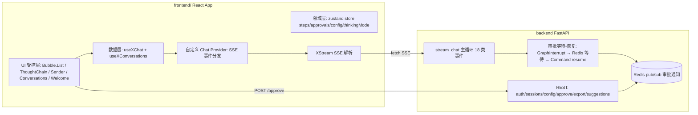

## Product Overview

将现有 Vue 前端全量重写为**官方 React 版 Ant Design X 应用**(数据智能体平台 DataAgent Pro),并在此过程中完成：审批从独立页移除、改为对话内 human-in-the-loop(阻塞对话→用户审批→恢复续流)、审批配置统一进配置中心、取消首页介绍页，以及一批已被归因的逻辑问题修复。Vue 前端冻结归档，期间不再维护。

## Core Features

1. **React 前端全量重建**(按 `x.ant.design/docs/react` 官方三层架构：UI 受控层 → useXChat/领域 store 数据层 → 自定义 Chat Provider + XStream 请求流层)：

- 对话页：会话侧栏(Conversations 风格，新建/删除/长期目标)、模型选择、模式(data/report/doc/task)、联网搜索开关；
- 消息区：Bubble.List + `@ant-design/x-markdown` 流式 Markdown + ThoughtChain 式步骤链(受控折叠：运行中展开、完成 2s 自动折叠、用户点击优先)，14 类消息渲染(text/status/sql/result/chart/error/reasoning/thinking/tool_*/clarification/plan/subagent/assistant 反馈/追问)；
- 输入区：Sender(生成中显示停止按钮、模式与模型 chips、追问建议上屏)、空态 Welcome + Prompts；
- 性能 statbar(首 token/耗时/上下文占用)、会话轨迹抽屉、导出 CSV/Excel；
- 登录页(JWT)、管理后台(LLM 配置去统计卡 + capabilities/思考强度、技能、MCP、定时任务、审批配置)；

2. **对话内审批 HITL**：后端在图中断点发 `approval_required` 后**保持 SSE 流挂起**，等待审批决策(Redis 通知)，收到后 `Command(resume)` 恢复并继续流式输出；对话内渲染审批卡片(通过/拒绝/意见)，权限沿用现有 tier 三档 + 非 admin 不可自审；审批管理独立页与入口移除；
3. **取消首页**：Home 介绍内容移入 VitePress 首页特性区(可选文档项)，根路由重定向 /chat；
4. **逻辑问题一并解决**：misc_agent 提示词友好化(闲聊正常应答)、标题 prompt 强化、空 plan 步骤不渲染卡片、步骤 1 空时折叠为摘要行、misc 工具卡与正文去重、`reasoning` 字段兼容(OpenRouter)全 Agent 推送思考；
5. **安全与兼容**：SSE 协议只增不改；已修复行为必须等价保留(并行 analyst/reporter 按 stepId 隔离的流式槽位、step_id 分组、token channel=sql 流式 SQL 卡片、thinking_mode 前端开关)。

## 硬性约束

- 不重启用户正在运行的服务(后端 --reload / vite HMR 自动生效；确需重启时只告知、由用户执行)；
- 后端 pytest 保持全绿(当前 43 passed)；
- React 应用放 frontend/ 原地替换，Vue 版本打 git tag vue-legacy 归档；同步更新 Dockerfile/CI 前端构建路径与文档启动说明；
- 前端设计遵循 frontend-design 规则：碳黑驾驶舱 + 紫磷光美学，拒绝通用 AI 观感；动效用 ReactBits；
- 最小惊讶原则：每阶段独立可验收、可回滚，commit 信息记录与设计的偏差。

## Tech Stack Selection

| 层 | 选型 | 理由 |
| --- | --- | --- |
| 框架 | Vite 6 + React 19 + TypeScript | 官方 React 版 antdx v2.9.0 的对齐基线 |
| UI | `@ant-design/x` 2.9.0 + antd 5(ConfigProvider darkAlgorithm) | 用户指定官方版；Bubble.List/ThoughtChain/Sender/Conversations/Welcome/Prompts/Attachments 齐备 |
| 数据流 | `@ant-design/x-sdk`(useXChat/useXConversations/Chat Provider/XRequest)+ `@ant-design/x-markdown` | 用户指定 x-sdk 文档；x-markdown 解决流式半截 Markdown 闪烁 |
| 流解析 | XStream(替换手写 buffer 行解析) | 官方 SSE 解析器 |
| 领域状态 | zustand(chat/sessions/auth/config/approvals) | 轻量；X SDK 管消息流，领域状态独立 |
| 路由 | react-router-dom v7 | 标准 |
| 图表 | echarts-for-react | 复用现有 echarts option(后端产出不变) |
| 表格 | antd Table | 替换 el-table(结果表格) |
| 动效 | ReactBits(官方 React 源)精选 3~5 个组件 | vue-bits 的官方对应物 |
| 后端 | 既有 FastAPI + LangGraph，**最小改造**(HITL 续流 + prompt) | x-sdk 是前端 SDK,后端不重构 |


## Implementation Approach

**整体策略**：三层架构落地为「自定义 Chat Provider 适配层」——后端 18 类 SSE 事件(step_id/channel/审批等)经 Provider 转换层注入消息流，useXChat 只承载通用消息状态机，领域扩展(步骤分组、并行槽位、审批卡)由 zustand store + 自定义消息类型承载(与今天 Vue R1 已验证的架构同构，只是换了渲染层)。后端协议不动，HITL 通过新增「审批等待-恢复」流内状态实现。

**关键决策**：

1. **useXChat 的边界**：其消息模型(content:string)承载不了 sql/result/chart/step 等富事件——消息正文仍用 messageRender 分发自定义 ReactNode，领域事件走 store(与官方「messageRender 自定义渲染」扩展点一致，不改其状态机)；
2. **HITL 采用流内等待**：GraphInterrupt 分支 yield approval_required 后不 break，改为订阅 Redis 审批频道(带超时兜底)，收到决策后同一 config graph.ainvoke(Command(resume)) 并继续 astream 输出——这是「langchain 阻塞对话」的标准模式；无活跃流时保留 approve.py 旧执行路径兜底；
3. **审批配置**：configs/approval_policy.json 既有 tier 机制并入配置中心新页面区块，复用 GET/PUT /approve/policy。

**性能与可靠性**：流式 token 高频更新按 stepId 分槽 + 消息就地变更(避免 React 重挂载)；审批等待用 asyncio.Event + Redis pub/sub，超时 5 分钟自动拒绝兜底；图表懒渲染(仅展开/可见时 mount)。

## Architecture Design



## Directory Structure

```
frontend/                              # [NEW] React 全量重建(Vue 版归档 tag vue-legacy)
├── src/
│   ├── main.tsx / App.tsx / router.tsx
│   ├── theme/tokens.ts               # [NEW] 碳黑驾驶舱 design tokens(antd darkAlgorithm + CSS 变量)
│   ├── api/client.ts                 # [NEW] fetch 封装 + JWT + 拦截器
│   ├── stores/{app,auth,chat,config,approval}.ts   # [NEW] zustand;chat 移植并行槽位/steps/thinkingMode/排队
│   ├── sdk/
│   │   ├── DataAgentProvider.ts      # [NEW] 自定义 Chat Provider:SSE 18 类事件分发
│   │   └── protocol.ts               # [NEW] 事件类型常量(与后端 stream_protocol 对齐)
│   ├── pages/{Login,Chat,AdminLayout,NotFound}.tsx
│   ├── pages/admin/{LlmConfig,SkillConfig,McpConfig,ScheduleConfig,ApprovalConfig}.tsx
│   ├── components/
│   │   ├── chat/{MessageList,MessageItem,StepChain,ApprovalCard,ReasoningCard,
│   │   │         ToolCard,SQLCard,ResultTable,ChartView,ClarifyCard,PlanCard,
│   │   │         SubagentNode,TrajectoryDrawer,StatBar}.tsx   # [NEW] 14 类渲染
│   │   ├── ChatSidebar.tsx / ModelSelector.tsx / ModeChips.tsx / WelcomePanel.tsx
│   │   └── bits/{TypeText,AuroraBackground}.tsx   # [NEW] ReactBits 精选
│   └── styles/global.css
backend/                               # [MODIFY] 仅两处
├── app/api/v1/chat.py                 # HITL:GraphInterrupt 分支等待审批 → resume → 续流
├── app/api/v1/approve.py              # 决策落库 + Redis 通知;无活跃流兜底旧路径
├── app/agents/misc_agent.py           # prompt 友好化(闲聊正常应答)
└── app/agents/title_generator.py      # prompt 强化(中文可读标题)
docs/                                  # [MODIFY] 启动说明 + 首页介绍移入
```

## Key Code Structures

1. **自定义 Chat Provider(前端)**：`request({ messages, onUpdate, onSuccess, onError, signal })` 内 fetch `/api/v1/chat/completions`，XStream 迭代 → 按 event.type 分发：token(channel)/reasoning/thinking/sql/result/chart/tool_*/plan/clarification/node_started(step_id)/approval_required/done/title → 部分转 onUpdate(消息增量)，部分直接写入 zustand store(步骤/审批/SQL 卡片)；
2. **后端审批协议(只增不改)**：复用既有 approval_required 事件 + POST /api/v1/chat/approve；新增流内等待：GraphInterrupt → yield approval_required → await wait_approval(run_id, timeout=300)(Redis pub/sub)→ Command(resume={approved, comment}) → 继续 graph.astream 输出 result/analysis/done；超时自动 approved=false；
3. **前端审批卡**：ApprovalCard 由 store 中 pending 审批渲染(通过/拒绝/意见输入)，点击调 /approve，状态随 SSE 续流自动转为已完成；
4. **领域消息类型**：`type Msg = { id, role, kind: 'text'|'sql'|'result'|'chart'|'tool'|'reasoning'|'thinking'|'plan'|'clarify'|'approval'|'error'|'status'|'subagent', stepId?, ... }`，stepId 为分组键，组内固定类型序 thinking→tool→正文。

## Implementation Notes

- 迁移 fidelity 清单(必须等价)：并行 token 分槽、步骤分组与固定类型序、channel=sql 流式卡片、thinking_mode 开关语义、排队发送、多轮 thread_id 复用、/cancel 停止；
- 后端改动保持 SSE 事件语义不变(仅新增流内等待行为)；approve.py 保留无活跃流的直接 ainvoke 兜底，防止旧调用方断裂；
- 每个 Phase 一个 commit；前端 build(vite build + tsc)与后端 pytest 作为阶段闸门；浏览器端到端验收用 chrome-devtools 走查真实页面；
- Vue 旧代码不删除，打 tag vue-legacy；frontend/ 目录原地替换(新 React 应用)，Dockerfile 若引用 frontend/dist 路径不变则零改。

## Design Style

**「碳黑驾驶舱 + 紫磷光」**：大面积碳黑(#0d0d0f/#18181b/#1f1f23 三层)承载 UI，品牌紫 #7056f8 为唯一强调色(运行态脉冲、品牌标识、主按钮)，磷光绿 #10b981 仅用于「已完成/成功」状态。拒绝白底紫渐变与通用 AI 观感。

- 布局：三栏驾驶舱——左侧 Conversations 会话栏(可折叠)、中间对话主区(Bubble.List + 步骤链)、底部 Sender；顶栏含模型选择器(等宽字体读数)+ 模式 chips + 轨迹按钮；空态为 Welcome + Prompts(ReactBits TypeText 打字机标题 + Aurora 呼吸背景，仅限欢迎页)；
- 步骤链：左侧竖轨 + 状态点(运行中紫点脉冲/完成绿点)，步骤头含「步骤 N · 标签 · 状态 chip」，运行中展开、完成 2s 自动折叠、点击优先——与 antdx ThoughtChain 视觉语言一致；
- 数据读数：性能 statbar、模型名、step_id、SQL 卡片均用等宽字体(DIN Next)，正文 PingFang SC/Noto Sans；
- 动效：仅三处高影响时刻——欢迎页入场(staggered reveal)、步骤状态切换(pulse/fade)、发送按钮 Click Spark；其余静态克制；
- 审批卡：对话内联卡片，紫色左边线 + 醒目操作按钮，审批中状态脉冲，完成后打戳归档；
- 响应式：≥1280px 三栏，768~1280px 侧栏可折叠，<768px 侧栏抽屉化(web 桌面优先，移动端可用)。

## Agent Extensions

### Skill

- **frontend-design**
- Purpose: 指导 React 新前端全量视觉实现(碳黑驾驶舱+紫磷光美学、字体/色彩/动效规范)
- Expected outcome: 产出区别于通用 AI 观感的高完成度界面，每阶段视觉走查有据
- **test-driven-development**
- Purpose: 新前端关键逻辑(SSE Provider 事件分发、审批状态机、并行槽位)先行编写失败测试再实现
- Expected outcome: 核心数据流有 vitest 覆盖，回归可自动化
- **verification-before-completion**
- Purpose: 每个 Phase 收尾前强制跑 build/pytest/浏览器验收，禁止无证据宣称完成
- Expected outcome: 每阶段交付附带验收证据(命令输出/截图)
- **executing-plans**
- Purpose: 本计划跨阶段执行时的批次管理与检查点汇报
- Expected outcome: 按 Phase 推进，阶段间等待用户验收反馈

### MCP

- **chrome-devtools**
- Purpose: 真实页面端到端验收(对话/查询/审批 HITL/历史会话/配置页)，抓 Console 与网络面板
- Expected outcome: 端到端行为验证 + 问题截图取证